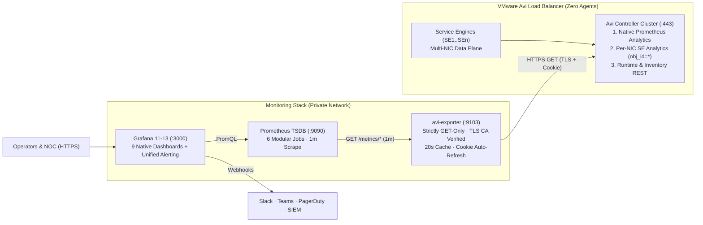

# VMware Avi Load Balancer Observability with Prometheus & Grafana

An agentless, strictly read-only observability kit for **VMware Avi Load Balancer (NSX ALB 30.x / 31.x / 32.x)** featuring:

- **Strictly Read-Only Prometheus Exporter (`exporters/avi_exporter.py`):** Zero third-party Python dependencies (~14 MiB RAM), full TLS CA verification, session cookie management, `20s` cache, and strict `GET` allowlisting (`405` on write methods, `404` on arbitrary paths).
- **Complete 6-Job Telemetry Coverage:** Native Avi Prometheus analytics + **per-interface multi-NIC Service Engine PPS/bandwidth** (`eth0`, `eth1`, ..., plus SE-wide totals) + **full runtime & inventory state** (`OPER_UP`/`OPER_DOWN`, missed SE heartbeats, VS-to-SE placement, licensed service cores %, pool member counts, and active controller alerts).
- **9 Modern Grafana 11–13 Dashboards (`dashboards/*.json`):** Native `schemaVersion: 41` dashboards (no deprecated Angular `singlestat`/`graph` plugins), dynamic `${datasource}` Prometheus selector (works on both 1-click UI Import and GitOps file provisioning), click-to-drill-down navigation, and collapsible L7/SSL/WAF rows.
- **10 Proactive Grafana Unified Alert Rules (`alerting/avi-alert-rules.yml`):** Ready-to-provision SLO and capacity rules across Virtual Services, Pools, Service Engines, Licensing, and Scrape Health.
- **Reference Architecture Guide PDF (`docs/VMware-Avi-Load-Balancer-Prometheus-Grafana-Architecture-Guide.pdf`):** Customer-ready architecture guide with vector data-flow & sequence diagrams.

---

## Architecture Overview



---

## Why `avi_exporter.py` Instead of Direct Scraping or Legacy Proxies?

| Capability | Direct Prometheus Scrape | Legacy `avi-api-proxy` | Legacy `metricscollection.py` | `avi_exporter.py` (This Repo) |
| :--- | :--- | :--- | :--- | :--- |
| **Prometheus Pull Native** | Fails (JSON-quoted string + `/login` cookies) | Yes | No (Graphite/Influx push-only) | **Yes** (unwraps text, valid `0.0.4`) |
| **Write-Path Security** | Depends on RBAC | High risk (unauthenticated `POST/PUT/PATCH/DELETE` to `/api/*`) | Read-only, TLS off by default | **Strict GET-Only** (6 allowlisted routes; `405`/`404` otherwise) |
| **TLS Verification** | Supported | `InsecureSkipVerify: true` default | `verify=False` default | **Verified** (system or custom enterprise CA bundle) |
| **Multi-NIC SE Per-Interface PPS** | No (aggregate only) | No (aggregate only) | Partial | **Full** (per-NIC RX/TX/Combined + SE-wide totals) |
| **Inventory & Oper State** | No | No | Yes | **Yes** (`OPER_UP`, heartbeats, cores %, placement, alerts) |
| **Controller Reboot Resilience** | Hammers auth | Exits if unreachable on boot | Script retries | **Resilient** (`20s` cache, clean `502`, auto-relogin) |

---

## Included Grafana 11–13 Dashboards (`dashboards/`)

All 9 dashboards are generated reproducibly by [`scripts/build_avi_dashboards.py`](scripts/build_avi_dashboards.py) with a dynamic **`Prometheus` (`${datasource}`) variable** — no hardcoded datasource UIDs!

| Dashboard JSON File | Scope | Key Visualizations |
| :--- | :--- | :--- |
| [`Avi-Summary.json`](dashboards/Avi-Summary.json) | Executive / NOC Overview | VS UP & %, SEs UP, Cluster Nodes, Total SE PPS (All NICs), Bandwidth, CPS, Licensed Cores % gauge, clickable Healthscore/Uptime drill-downs, Active Alerts |
| [`Avi-Service-Engine-Specific.json`](dashboards/Avi-Service-Engine-Specific.json) | Single SE & Multi-NIC Deep Dive | Oper Status, Healthscore, CPU/Mem/ConnMem gauges, **5-way SE Memory Breakdown**, **Per-Interface RX/TX/Combined PPS**, **Entire SE Combined PPS**, Missed Heartbeats, Packet Drops & Mbuf Failures |
| [`Avi-Service-Engines-Total.json`](dashboards/Avi-Service-Engines-Total.json) | Multi-SE Fleet Comparison | Healthscore / Mem / ConnMem bar gauges, Combined Total PPS per SE, Per-Interface PPS across all SEs/NICs, Top 5 Bandwidth & CPU, VS Capacity % |
| [`Avi-Virtual-Services-Specific.json`](dashboards/Avi-Virtual-Services-Specific.json) | Application / VIP Detail | Oper Status, Healthscore, % SEs UP, Bandwidth, CPS, Open Conns, RTT & Lossy Conns, SE Placement, **DNS Queries & Errors**, collapsible L7 HTTP/SSL/4xx-5xx/ApDex |
| [`Avi-Virtual-Services-Total.json`](dashboards/Avi-Virtual-Services-Total.json) | Top Talkers & VIP Fleet | Healthscore bar gauges, Oper Status pills, Top 10 Bandwidth/CPS/Concurrent Conns/RX-TX PPS, collapsible Top 10 SSL TPS |
| [`Avi-Pool-Specific.json`](dashboards/Avi-Pool-Specific.json) | Backend Server Visibility | Pool Oper Status, Servers UP/Enabled/Total, per-member Bandwidth/CPS/RTT/PPS, cumulative range TX/RX packet & byte tables, collapsible L7 App Latency |
| [`Avi-Controller.json`](dashboards/Avi-Controller.json) | Control Plane Health | Cluster Leader badge, Active Nodes, Fleet counts, Licensed Cores %, CPU %, Avg/Max Mem %, Disk %, Disk Read/Write I/O, Active Alerts |
| [`Avi-Virtual-Services-WAF-Sizing.json`](dashboards/Avi-Virtual-Services-WAF-Sizing.json) | L7 WAF & HTTP Sizing | End-to-End Timing, WAF Evaluated/Matched/Rejected/Disabled, GET/POST/Bypass %, POST Bytes, URI Length, Header/Param Counts |
| [`Avi-dashboards.json`](dashboards/Avi-dashboards.json) | Navigation Hub | Tag-driven directory indexing all Avi dashboards |

---

## Quick Start (Docker Compose)

```bash
git clone https://github.com/mitchchen/avi-prometheus-grafana.git
cd avi-prometheus-grafana

# 1. Configure a dedicated read-only Avi Controller user
mkdir -p secrets certs
cp .env.example secrets/avi-exporter.env
chmod 600 secrets/avi-exporter.env
# Edit secrets/avi-exporter.env with your read-only AVI_USERNAME / AVI_PASSWORD

# 2. Place your enterprise/internal root CA bundle (or omit AVI_CA_FILE for public CA)
cp /path/to/your-root-ca.pem certs/corp-root-ca.pem

# 3. Update AVI_CONTROLLER & AVI_API_VERSION in docker-compose.example.yml
#    and friendly instance name in prometheus/prometheus-avi.yml

# 4. Launch avi-exporter + Prometheus + Grafana (all 9 dashboards auto-provisioned!)
docker compose -f docker-compose.example.yml up -d
```

Open Grafana at `http://localhost:3000` → **Dashboards → Avi Load Balancer → Avi — Summary (Overview)**.

### Importing Dashboards into an Existing Grafana Instance

- **Option A — Grafana UI (1-Click Import):** Go to **Dashboards → New → Import → Upload dashboard JSON file** and upload any file from `dashboards/`. Pick your existing Prometheus datasource in the top **Prometheus** dropdown.
- **Option B — File / GitOps Provisioning:** Copy `dashboards/*.json` to `/var/lib/grafana/dashboards-avi` and drop [`grafana/provisioning/dashboards/avi-dashboards.yml`](grafana/provisioning/dashboards/avi-dashboards.yml) into `/etc/grafana/provisioning/dashboards/`.

### Kubernetes Deployment

See [`k8s/avi-exporter.yaml`](k8s/avi-exporter.yaml) for a ready-to-apply `Deployment`, internal `ClusterIP` `Service`, and Prometheus Operator `ServiceMonitor`.

---

## Running Unit Tests & Regenerating Dashboards

```bash
# Run exporter unit tests (zero external dependencies)
python3 -m unittest discover -s exporters -p 'test_*.py' -v

# Regenerate all 9 Grafana dashboard JSONs after customizing scripts/build_avi_dashboards.py
python3 scripts/build_avi_dashboards.py
```

---

## Documentation

- **Full Technical Architecture Guide (PDF):** [`docs/VMware-Avi-Load-Balancer-Prometheus-Grafana-Architecture-Guide.pdf`](docs/VMware-Avi-Load-Balancer-Prometheus-Grafana-Architecture-Guide.pdf)

## License

Licensed under the [Apache License 2.0](LICENSE).
