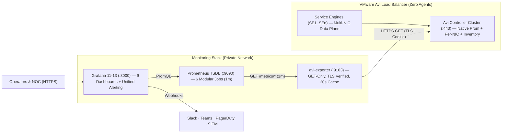

# VMware Avi Load Balancer Observability with Prometheus & Grafana

An agentless, strictly read-only observability kit for **VMware Avi Load Balancer (NSX ALB 30.x / 31.x / 32.x)** featuring:

- **Strictly Read-Only Prometheus Exporter (`exporters/avi_exporter.py`):** Zero third-party Python dependencies (~14 MiB RAM), full TLS CA verification, session cookie management, `20s` cache, and strict `GET` allowlisting (`405` on write methods, `404` on arbitrary paths).
- **Complete 6-Job Telemetry Coverage:** Native Avi Prometheus analytics + **per-interface multi-NIC Service Engine PPS/bandwidth** (`eth0`, `eth1`, ..., plus SE-wide totals) + **full runtime & inventory state** (`OPER_UP`/`OPER_DOWN`, missed SE heartbeats, VS-to-SE placement, licensed service cores %, pool member counts, and active controller alerts).
- **9 Modern Grafana 11–13 Dashboards (`dashboards/*.json`):** Native `schemaVersion: 41` dashboards (no deprecated Angular `singlestat`/`graph` plugins), dynamic `${datasource}` Prometheus selector (works on both 1-click UI Import and GitOps file provisioning), click-to-drill-down navigation, and collapsible L7/SSL/WAF rows.
- **10 Proactive Grafana Unified Alert Rules (`alerting/avi-alert-rules.yml`):** Ready-to-provision SLO and capacity rules across Virtual Services, Pools, Service Engines, Licensing, and Scrape Health.
- **Reference Architecture Guide PDF (`docs/VMware-Avi-Load-Balancer-Prometheus-Grafana-Architecture-Guide.pdf`):** Customer-ready 7-page architecture guide with vector data-flow & sequence diagrams.

---

## Architecture Overview



---

## Why `avi_exporter.py` Instead of Direct Scraping or Legacy Proxies?

| Capability | Direct Prometheus Scrape | Legacy `avi-api-proxy` | Legacy `metricscollection.py` | `avi_exporter.py` (This Repo) |
| :--- | :--- | :--- | :--- | :--- |
| **Prometheus Pull Native** | Fails (JSON-quoted string + `/login` cookies) | Yes | No (Graphite/Influx push-only) | **Yes** (unwraps text, valid `0.0.4`) |
| **Write-Path Security** | Depends on RBAC | High risk (unauthenticated `POST/PUT/PATCH/DELETE` to `/api/*`) | Read-only, TLS off by default | **Strict GET-Only** (6 allowlisted routes; `405`/`404` otherwise) |
| **TLS Verification** | Supported | `InsecureSkipVerify: true` default | `verify=False` default | **Verified** (system or custom enterprise CA bundle) |
| **Multi-NIC SE Per-Interface PPS** | No (aggregate only) | No (aggregate only) | Partial | **Full** (per-NIC RX/TX/Combined + SE-wide totals) |
| **Inventory & Oper State** | No | No | Yes | **Yes** (`OPER_UP`, heartbeats, cores %, placement, alerts) |
| **Controller Reboot Resilience** | Hammers auth | Exits if unreachable on boot | Script retries | **Resilient** (`20s` cache, clean `502`, auto-relogin) |

---

## Quick Start (Docker Compose — Step-by-Step)

This launches the complete stack (`avi-exporter` + `prometheus` + `grafana` with all 9 Avi dashboards and 10 alert rules auto-provisioned) in ~5 minutes.

### Prerequisites
- A Linux or macOS host with **Docker** and **Docker Compose v2** (`docker compose version`).
- Outbound HTTPS (**TCP 443**) from the Docker host to your Avi Controller management VIP/FQDN.
- Your Avi Controller version (shown in the Avi UI top-right menu, or check via `curl -sk https://<your-controller>/api/initial-data | grep -o '"Version": "[^"]*"'`).

---

### Step 1 — Create a Dedicated Read-Only User in the Avi Controller UI

Never use the full `admin` account in production. Create a least-privilege read-only user in your Avi Controller:

1. Log into the Avi Controller UI and navigate to **Administration → Accounts → Users → Create**.
2. Configure the user:
   - **Username:** `prometheus-ro` (or your preferred service account name)
   - **Password:** Set a strong password (you will place this in `secrets/avi-exporter.env` in Step 2)
   - **Role:** **`System-Read-Access`** *(built-in read-only role across the Controller — required so all 6 scrape jobs, including cluster runtime, licensing ledger, Service Engines, Virtual Services, Pools, and Controller alerts, succeed with zero write permission)*
   - **Tenant:** `admin` *(or **All Tenants** if you plan to scrape multiple Avi tenants from this exporter)*
3. Click **Save**.

---

### Step 2 — Clone the Repo & Create `secrets/avi-exporter.env`

`secrets/` holds your Avi read-only credentials outside of `docker-compose.example.yml` so passwords are never committed to Git (`secrets/` is already listed in `.gitignore`).

```bash
git clone https://github.com/mitchchen/avi-prometheus-grafana.git
cd avi-prometheus-grafana

# Create the local secrets/ and certs/ directories
mkdir -p secrets certs

# Copy the template and restrict permissions to owner read/write only
cp .env.example secrets/avi-exporter.env
chmod 600 secrets/avi-exporter.env
```

Now edit `secrets/avi-exporter.env` with your text editor (`nano secrets/avi-exporter.env` or `vi secrets/avi-exporter.env`) so it contains **only** these two lines with the read-only credentials from Step 1:

```env
AVI_USERNAME=prometheus-ro
AVI_PASSWORD=YourStrongReadOnlyPasswordHere
```

> **Important Docker Compose tip:** Do **not** wrap the username or password in quotes (`"..."` or `'...'`). Docker Compose `env_file:` passes quotes literally as part of the password, which causes Avi `POST /login` to return HTTP `401`.

---

### Step 3 — Configure the Avi Controller TLS Certificate (`certs/`)

`avi-exporter` enforces full HTTPS certificate verification against your Avi Controller—it never disables TLS verification. Choose **one** of the three options below matching how your Avi Controller's portal certificate is signed:

#### Option A — Enterprise / Internal CA-Signed Portal Certificate *(Most Common in Production)*
Copy your organization's PEM-encoded **Root CA** certificate (and Intermediate CA, if applicable, concatenated into one PEM file starting with `-----BEGIN CERTIFICATE-----`) into `certs/corp-root-ca.pem`:

```bash
cp /path/to/your-enterprise-root-ca.pem certs/corp-root-ca.pem
```

Verify the trust chain from the Docker host before starting containers (replace `avi-ctrl.corp.example` with your Controller FQDN):

```bash
openssl s_client -connect avi-ctrl.corp.example:443 \
  -CAfile certs/corp-root-ca.pem -verify_return_error </dev/null >/dev/null && echo "TLS OK"
```

#### Option B — Avi Default Self-Signed Certificate *(Lab / PoC)*
Export the Avi Controller's portal certificate directly into `certs/corp-root-ca.pem` so `avi-exporter` pins and verifies it cleanly:

```bash
openssl s_client -showcerts -connect avi-ctrl.corp.example:443 </dev/null 2>/dev/null \
  | openssl x509 -outform PEM > certs/corp-root-ca.pem
```

> **Note:** Python TLS verifies both the certificate and the hostname/IP SAN. Make sure `AVI_CONTROLLER` in Step 4 matches a DNS name or IP listed in the certificate's Subject Alternative Name (`SAN`).

#### Option C — Publicly Trusted CA Certificate *(DigiCert, Sectigo, Let's Encrypt, etc.)*
Nothing is needed in `certs/`! Simply remove or comment out these two lines in `docker-compose.example.yml`:
- `- AVI_CA_FILE=/etc/ssl/certs/corp-root-ca.pem`
- `- ./certs/corp-root-ca.pem:/etc/ssl/certs/corp-root-ca.pem:ro`

When `AVI_CA_FILE` is unset, `avi_exporter.py` automatically validates TLS using the container's standard OS CA trust store.

---

### Step 4 — Set Your Controller Address, API Version, and Friendly Label

You only need to update **two files** before starting the stack:

1. **`docker-compose.example.yml`** — under `services.avi-exporter.environment`, set your real Avi Controller FQDN/IP and software version:
   ```yaml
   environment:
     - AVI_CONTROLLER=avi-ctrl.corp.example      # Replace with your Controller FQDN or IP
     - AVI_API_VERSION=32.1.4                    # Replace with your Avi version (e.g. 30.2.1, 31.2.1, 32.1.4)
     - AVI_TENANT=admin                          # Default Avi tenant
     - AVI_CA_FILE=/etc/ssl/certs/corp-root-ca.pem  # Remove this + certs mount if using Option C (public CA)
   ```
   *(Also change `GF_SECURITY_ADMIN_PASSWORD=admin` under `services.grafana.environment` before exposing Grafana on a shared network.)*

2. **`prometheus/prometheus-avi.yml`** — replace `avi-prod-west` with a friendly label for your Avi Controller cluster (this label populates Grafana's **Controller** dropdown):
   ```bash
   # Works on both macOS and Linux (replace 'avi-us-east-prod' with your cluster name)
   sed -i.bak 's/avi-prod-west/avi-us-east-prod/g' prometheus/prometheus-avi.yml && rm -f prometheus/prometheus-avi.yml.bak
   ```

---

### Step 5 — Launch and Verify End-to-End

Start all three containers in the background:

```bash
docker compose -f docker-compose.example.yml up -d
docker compose -f docker-compose.example.yml ps
```

**1. Test `avi-exporter` connectivity, login, and TLS directly (takes 2 seconds):**

```bash
# Liveness check -> should print "ok"
docker compose -f docker-compose.example.yml exec avi-exporter \
  wget -qO- http://localhost:9103/healthz

# Live Avi Controller scrape test -> should print avi_controller_version_info & inventory gauges
docker compose -f docker-compose.example.yml exec avi-exporter \
  wget -qO- 'http://localhost:9103/metrics/inventory?tenant=admin' | head -n 25
```

If this returns a `502` error, run `docker compose -f docker-compose.example.yml logs avi-exporter` for the exact reason (see Troubleshooting below).

**2. Confirm all 6 Prometheus scrape jobs are `up` (wait ~60 seconds after startup):**

```bash
docker compose -f docker-compose.example.yml exec prometheus \
  wget -qO- http://localhost:9090/api/v1/targets \
  | grep -o '"job":"avi_[^"]*"\|"health":"[^"]*"'
```

You should see all 6 jobs (`avi_controller`, `avi_serviceengine`, `avi_serviceengine_interfaces`, `avi_inventory`, `avi_virtualservice`, `avi_pool`) reporting `"health":"up"`.

**3. Open Grafana:**
- Browse to `http://<your-docker-host>:3000`
- Sign in (`admin` / `admin` unless changed in Step 4)
- Navigate to **Dashboards → Avi Load Balancer → Avi — Summary (Overview)**

---

### `avi-exporter` Environment Variables Reference

| Variable | Required | Default | Description |
| :--- | :---: | :--- | :--- |
| `AVI_CONTROLLER` | **Yes** | *(none)* | Avi Controller FQDN or IP (optionally `host:port` if non-443). Must match TLS cert SAN. |
| `AVI_USERNAME` | **Yes** | *(none)* | Dedicated read-only Avi Controller username (set in `secrets/avi-exporter.env`). |
| `AVI_PASSWORD` | **Yes** | *(none)* | Read-only Avi Controller password (set in `secrets/avi-exporter.env`). |
| `AVI_API_VERSION` | No | `32.1.4` | Sent as `X-Avi-Version` header. Set to match your Controller version (`>= 30.2.1` on Avi 32.1.4+). |
| `AVI_TENANT` | No | `admin` | Default `X-Avi-Tenant` when `?tenant=` query param is omitted. |
| `AVI_CA_FILE` | No | *(system CA)* | Path inside container to PEM CA bundle (e.g. `/etc/ssl/certs/corp-root-ca.pem`). Leave unset for public CAs. |
| `AVI_EXPORTER_PORT` | No | `9103` | Internal HTTP listen port (kept private on the Docker `monitoring` network). |
| `AVI_CACHE_TTL` | No | `20` | In-memory response cache duration (seconds) per `(entity, tenant)`. |
| `AVI_TIMEOUT` | No | `40` | Upstream HTTPS request timeout (seconds) to the Avi Controller. |

---

### Troubleshooting Common First-Run Errors

- **`Avi login failed with HTTP 401`:** Verify `AVI_USERNAME` and `AVI_PASSWORD` in `secrets/avi-exporter.env`, and confirm there are **no quotes** around the values.
- **`Avi GET ... failed with HTTP 403`:** The Avi user lacks read permission for that endpoint—assign the built-in **`System-Read-Access`** role in **Administration → Accounts → Users**.
- **`SSLCertVerificationError` / `CERTIFICATE_VERIFY_FAILED`:** Either `certs/corp-root-ca.pem` does not contain the CA that signed your Controller's portal cert, or `AVI_CONTROLLER` does not match a DNS/IP SAN in that certificate. Re-test with the `openssl s_client` command in Step 3.
- **`Avi GET ... failed with HTTP 400`:** Update `AVI_API_VERSION` in `docker-compose.example.yml` to match your Avi Controller's running version.
- **Grafana shows `No data` right after startup:** Wait 60–90 seconds for Prometheus's first 1-minute scrape cycle, verify all 6 targets are `"health":"up"`, and confirm the **Prometheus**, **Controller**, and **Tenant** dropdowns at the top of the dashboard are populated.

---

## Included Grafana 11–13 Dashboards (`dashboards/`)

All 9 dashboards are generated reproducibly by [`scripts/build_avi_dashboards.py`](scripts/build_avi_dashboards.py) with a dynamic **`Prometheus` (`${datasource}`) variable** — no hardcoded datasource UIDs!

| Dashboard JSON File | Scope | Key Visualizations |
| :--- | :--- | :--- |
| [`Avi-Summary.json`](dashboards/Avi-Summary.json) | Executive / NOC Overview | VS UP & %, SEs UP, Cluster Nodes, Total SE PPS (All NICs), Bandwidth, CPS, Licensed Cores % gauge, clickable Healthscore/Uptime drill-downs, Active Alerts |
| [`Avi-Service-Engine-Specific.json`](dashboards/Avi-Service-Engine-Specific.json) | Single SE & Multi-NIC Deep Dive | Oper Status, Healthscore, CPU/Mem/ConnMem gauges, **5-way SE Memory Breakdown**, **Per-Interface RX/TX/Combined PPS**, **Entire SE Combined PPS**, Missed Heartbeats, Packet Drops & Mbuf Failures |
| [`Avi-Service-Engines-Total.json`](dashboards/Avi-Service-Engines-Total.json) | Multi-SE Fleet Comparison | Healthscore / Mem / ConnMem bar gauges, Combined Total PPS per SE, Per-Interface PPS across all SEs/NICs, Top 5 Bandwidth & CPU, VS Capacity % |
| [`Avi-Virtual-Services-Specific.json`](dashboards/Avi-Virtual-Services-Specific.json) | Application / VIP Detail | Oper Status, Healthscore, % SEs UP, Bandwidth, CPS, Open Conns, RTT & Lossy Conns, SE Placement, **DNS Queries & Errors**, collapsible L7 HTTP/SSL/4xx-5xx/ApDex |
| [`Avi-Virtual-Services-Total.json`](dashboards/Avi-Virtual-Services-Total.json) | Top Talkers & VIP Fleet | Healthscore bar gauges, Oper Status pills, Top 10 Bandwidth/CPS/Concurrent Conns/RX-TX PPS, collapsible Top 10 SSL TPS |
| [`Avi-Pool-Specific.json`](dashboards/Avi-Pool-Specific.json) | Backend Server Visibility | Pool Oper Status, Servers UP/Enabled/Total, per-member Bandwidth/CPS/RTT/PPS, cumulative range TX/RX packet & byte tables, collapsible L7 App Latency |
| [`Avi-Controller.json`](dashboards/Avi-Controller.json) | Control Plane Health | Cluster Leader badge, Active Nodes, Fleet counts, Licensed Cores %, CPU %, Avg/Max Mem %, Disk %, Disk Read/Write I/O, Active Alerts |
| [`Avi-Virtual-Services-WAF-Sizing.json`](dashboards/Avi-Virtual-Services-WAF-Sizing.json) | L7 WAF & HTTP Sizing | End-to-End Timing, WAF Evaluated/Matched/Rejected/Disabled, GET/POST/Bypass %, POST Bytes, URI Length, Header/Param Counts |
| [`Avi-dashboards.json`](dashboards/Avi-dashboards.json) | Navigation Hub | Tag-driven directory indexing all Avi dashboards |

---

## Importing Dashboards into an Existing Grafana / Prometheus Stack

Already running Prometheus and Grafana? You don't need the full Docker Compose stack:

1. **Run only `avi-exporter`** (either the `avi-exporter` service block from `docker-compose.example.yml` or Kubernetes [`k8s/avi-exporter.yaml`](k8s/avi-exporter.yaml)).
2. **Add the 6 scrape jobs** from [`prometheus/prometheus-avi.yml`](prometheus/prometheus-avi.yml) into your existing Prometheus configuration and reload Prometheus.
3. **Import the 9 dashboards into Grafana:**
   - **Option A — Grafana UI (1-Click Import):** Go to **Dashboards → New → Import → Upload dashboard JSON file** and upload the files from `dashboards/`. Pick your existing Prometheus datasource in the top **Prometheus** dropdown.
   - **Option B — File / GitOps Provisioning:** Copy `dashboards/*.json` to `/var/lib/grafana/dashboards-avi` and drop [`grafana/provisioning/dashboards/avi-dashboards.yml`](grafana/provisioning/dashboards/avi-dashboards.yml) into `/etc/grafana/provisioning/dashboards/`.
4. *(Optional)* **Add Proactive Alerts:** Copy [`alerting/avi-alert-rules.yml`](alerting/avi-alert-rules.yml) into `/etc/grafana/provisioning/alerting/` and update `datasourceUid: prometheus` to match your Prometheus datasource UID.

### Multi-Controller & Multi-Tenant Scaling
- **Multiple Avi Tenants on one Controller:** Duplicate the tenant-scoped jobs in `prometheus/prometheus-avi.yml` with different `params.tenant` values (e.g., `tenant: ['app-team-a']`). All tenants appear automatically in Grafana's **Tenant** dropdown.
- **Multiple Avi Controllers:** Run one lightweight `avi-exporter` container per Controller (each with its own `AVI_CONTROLLER` and `env_file`), and set a unique `replacement:` value under `metric_relabel_configs` in Prometheus (e.g., `avi-prod-west`, `avi-prod-east`). All Controllers appear in Grafana's **Controller** dropdown.

---

## Running Unit Tests & Regenerating Dashboards

```bash
# Run exporter unit tests (zero external dependencies)
python3 -m unittest discover -s exporters -p 'test_*.py' -v

# Regenerate all 9 Grafana dashboard JSONs after customizing scripts/build_avi_dashboards.py
python3 scripts/build_avi_dashboards.py
```

---

## Documentation

- **Full Technical Architecture Guide (PDF):** [`docs/VMware-Avi-Load-Balancer-Prometheus-Grafana-Architecture-Guide.pdf`](docs/VMware-Avi-Load-Balancer-Prometheus-Grafana-Architecture-Guide.pdf)

## License

Licensed under the [Apache License 2.0](LICENSE).
